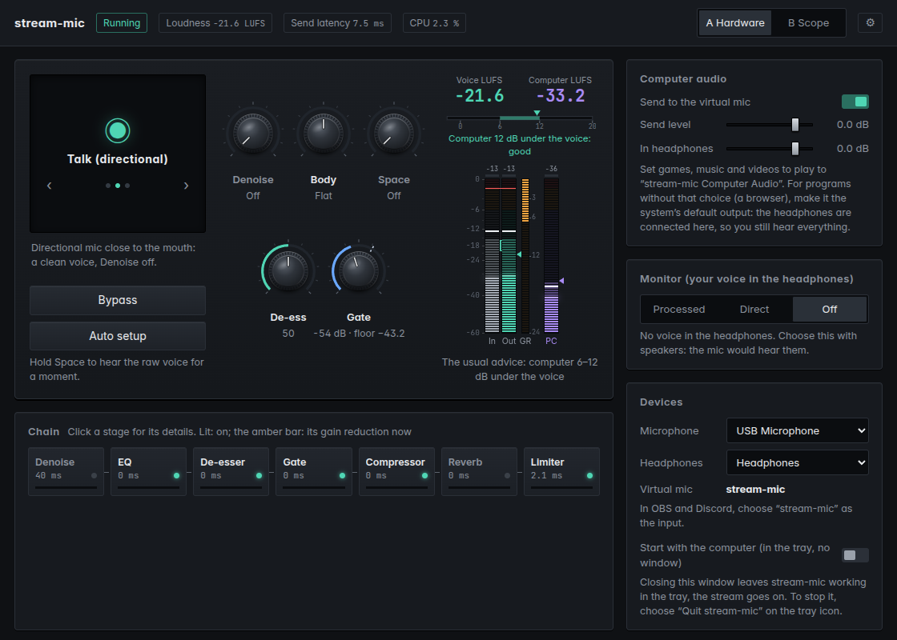
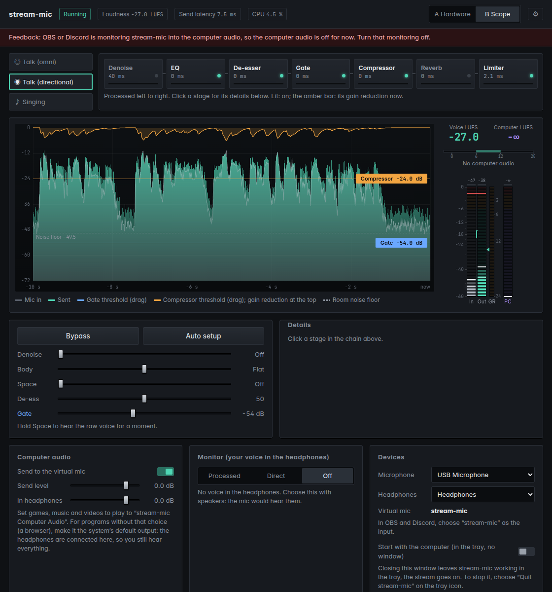
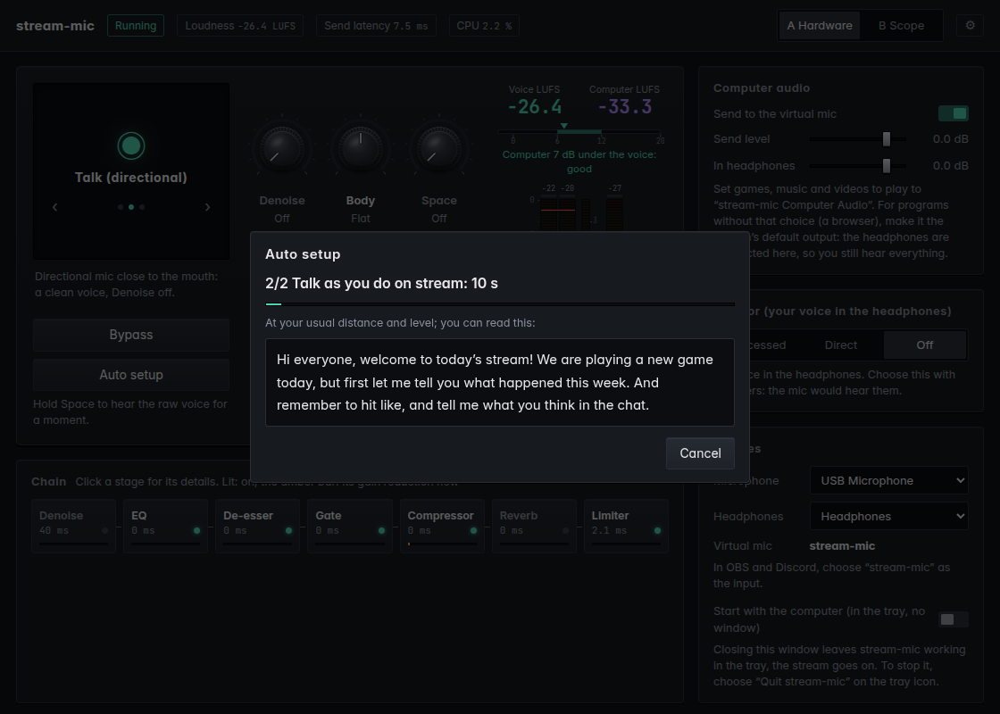

# stream-mic

Microphone processing for live streaming, as a virtual microphone. Pick a mode for your mic, press **Auto setup**,
talk for ten seconds, and choose `stream-mic` in OBS or Discord. Denoise, EQ, de-esser, gate, compressor, reverb and
limiter run in a fixed chain behind it; the computer's sound (games, music) can be mixed in at a level that sits
under the voice.

[繁體中文使用說明](docs/guide.zh-TW.md) · [English guide](docs/guide.en.md)

**Status:** in development, no release yet. It runs on Linux (PipeWire) and Windows 10 (2004 or later) and 11; the
downloads will be on the Releases page once there is one. Until then it can be built from source (below).

## What it does

- **Three modes** to start from: *Talk (omni)* for a laptop or lavalier mic that hears the room, *Talk
  (directional)* for a USB or XLR mic close to the mouth, *Singing*, where long notes are not taken for noise and a
  little reverb follows the backing track.
- **Auto setup** listens to 3 seconds of the room and 10 seconds of you talking, then sets the gate above the room's
  noise, the compressor to a few dB of reduction while you talk, and the level to -18 LUFS. It warns when the mic is
  too quiet or close to clipping, when the room is nearly as loud as the voice, or when the mic hears the speakers.
- **Five knobs** for what people change most: Denoise, Body, Space, De-ess and Gate. Every stage of the chain can
  still be opened, switched off, or kept out of the headphones on its own.
- **Computer audio** mixed into the virtual mic, with the balance against the voice measured in LUFS and a hint when
  the computer is too loud or too quiet. On Windows every program's sound is picked up by itself; on Linux programs
  play to the `stream-mic Computer Audio` output.
- **Monitoring** in the headphones: the processed voice, or nothing from here when the interface's own direct
  monitor is used.
- **Low latency:** about 7.5 ms from the mic to the virtual mic with Denoise off (Denoise, DeepFilterNet3, adds
  about 40 ms; the page shows each stage's share).
- **Two layouts** with the same controls: *Hardware* (knobs and meters) and *Scope* (the last 10 seconds of the
  voice, with the gate and compressor thresholds to drag). Traditional Chinese and English.
- A window plus a tray icon: closing the window leaves the processing running, and it can start with the computer.

| Scope layout | Auto setup |
| --- | --- |
|  |  |

## How it works

The engine (`crates/engine`) runs the chain on 128-sample blocks at 48 kHz and serves the settings page on
`127.0.0.1`. The app (`app/`, Tauri 2) shows that page in a window and adds the tray icon.

- **Linux:** PipeWire streams. stream-mic makes the virtual mic `stream-mic` (a source OBS and Discord see) and the
  output `stream-mic Computer Audio`.
- **Windows:** WASAPI. The processed voice goes to VB-CABLE (VB-Audio's virtual audio cable, installed separately),
  which OBS and Discord see as `CABLE Output`. Computer audio comes in through process loopback (Windows 10 2004+),
  leaving stream-mic itself out.

The chain, in order: Denoise (DeepFilterNet3, low-latency model) → Low Cut (12 dB/oct) → EQ (200 Hz shelf, a mid
bell, a presence bell, 10 kHz shelf, high cut) → De-esser → Gate (expander) → Compressor → Reverb → Limiter (-1 dBTP). The DSP is in `crates/dsp`, the
chain and the presets in `crates/chain`, the auto setup in `crates/chain/src/autoset.rs`.

## Building from source

Rust (stable) on either system.

**Linux** (Ubuntu 24.04 / Linux Mint 22 or newer):

    sudo apt install build-essential pkg-config clang libclang-dev libpipewire-0.3-dev \
      libwebkit2gtk-4.1-dev libayatana-appindicator3-dev librsvg2-dev libxdo-dev libssl-dev
    cargo build --release --manifest-path app/Cargo.toml
    ./app/target/release/stream-mic

`build/app.sh` does the same inside an Ubuntu 24.04 container (podman), so the program also runs on 24.04-based
systems when it is built on a newer one.

**Windows:** build natively with `cargo build --release --manifest-path app/Cargo.toml`, or cross-compile from Linux
for `x86_64-pc-windows-gnu` (mingw-w64). `stream-mic.exe` needs `WebView2Loader.dll` beside it (found in the build
output) and VB-CABLE installed.

`build/package.sh` makes the download archives: the program, the instructions, `LICENSE`, `NOTICE` and the
third-party license list (`tools/third_party.py`).

The engine alone, without a window (for testing, or a machine without a desktop):

    cargo build --release -p stream-mic-engine
    ./target/release/stream-mic --list                     # the audio devices
    ./target/release/stream-mic --mic NODE --out NODE      # then open http://127.0.0.1:8790/

## Tests and measurement tools

    cargo test --workspace                                 # DSP, chain and engine unit tests

`tools/` holds Python measurement tools (a uv project): reference implementations to check the DSP against
(`refcomp.py`, `refeq.py`, `refexp.py`, `reflim.py`, `refverb.py`), the benchmarks used to compare open-source
plugins and choose the designs (`*_bench.py`, `run_lv2.py`, `lv2host.py`), and end-to-end tests that run the built
program against virtual devices (`func_test.py`, `browser_test.py`, `app_test.py`).

    cd tools
    uv run python measure.py static|gain|response|decay|thd IN OUT [--plot P.png]
    uv run tools/func_test.py BINARY                       # from the repo root; Linux with PipeWire

## License

stream-mic is licensed under the Apache License, Version 2.0 ([LICENSE](LICENSE)). Third-party parts (DeepFilterNet and
its model, the Rust crates, the fonts, WebView2Loader.dll, and the VB-CABLE driver pack in the Windows download, which
keeps VB-Audio's own terms) are listed in [NOTICE](NOTICE); each download also carries THIRD_PARTY_LICENSES.txt
(made by `tools/third_party.py`).
