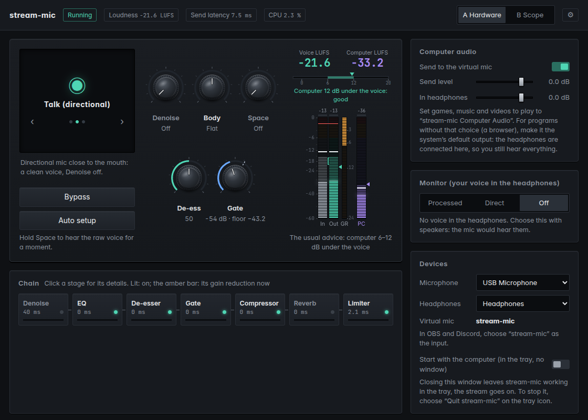
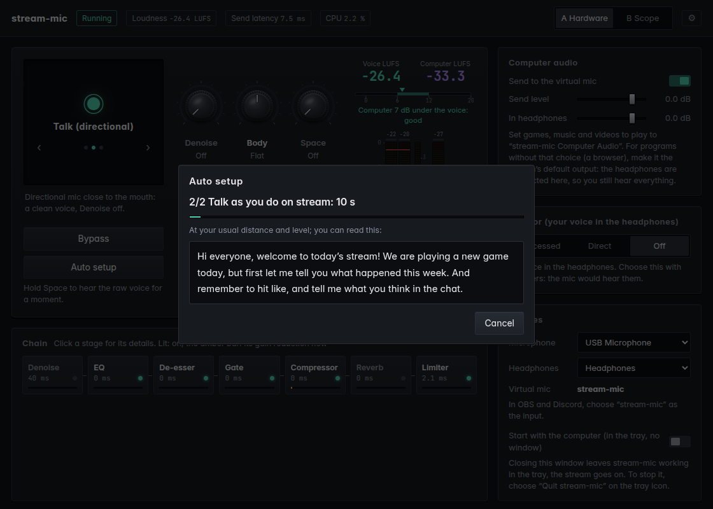
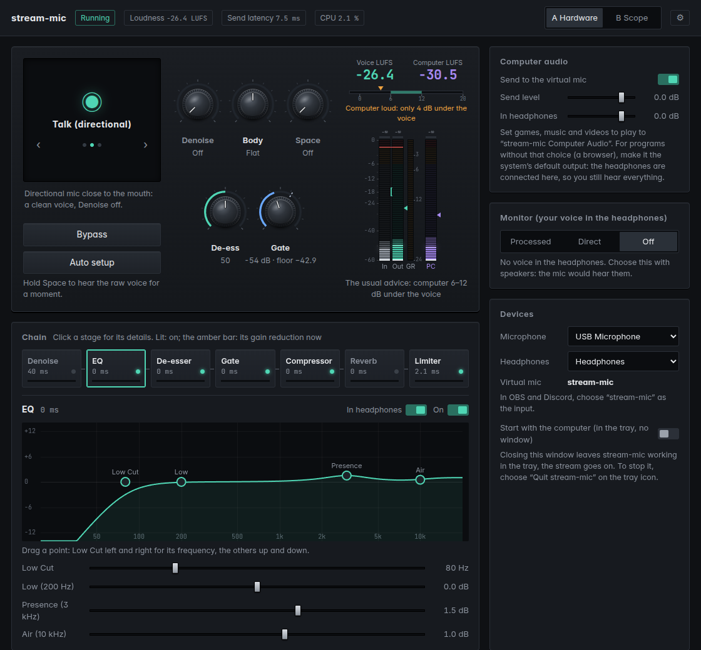
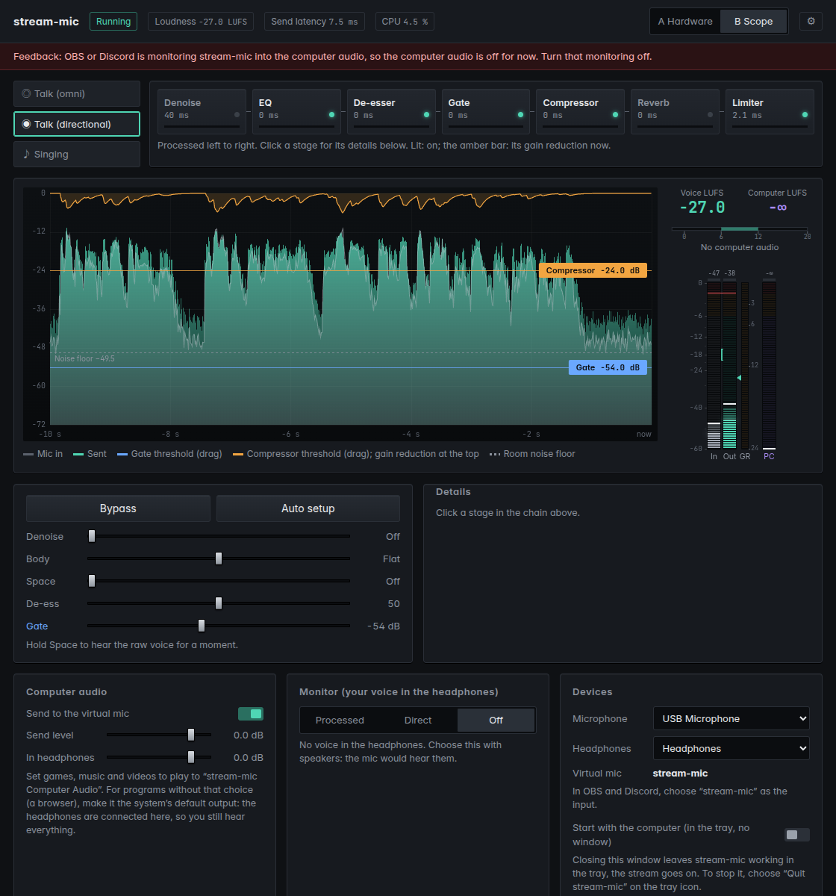

# stream-mic guide

[繁體中文](guide.zh-TW.md) · [Back to the README](../README.md)

stream-mic cleans up your microphone and sends the result to a virtual microphone. It handles noise, EQ, sibilance,
gate, compression, space and limiting. In OBS and Discord, you choose that virtual mic as the input. Computer audio,
such as games and music, can go out with it.

> stream-mic is in development and has no release yet.

## What you need

**Windows**
- Windows 10 version 2004 or later, or Windows 11. Picking up the computer audio needs it.
- VB-CABLE, a virtual audio cable. stream-mic sends the processed voice into it. The Windows download includes its
  installer, or get it from [vb-cable.com](https://vb-audio.com/Cable/).

**Linux**
- PipeWire. Ubuntu 22.10, Linux Mint 22 and later use it by default.
- WebKitGTK 4.1 (the window) and AppIndicator (the tray icon):

      sudo apt install libwebkit2gtk-4.1-0 libayatana-appindicator3-1

**Both**
- Headphones. With speakers, the mic hears the speakers, and the computer audio goes out twice.

## Installing

**Windows**
1. Unzip the whole folder somewhere it can stay, for example Documents\stream-mic. `stream-mic.exe` and
   `WebView2Loader.dll` must be in the same folder.
2. Install VB-CABLE:
   - Unzip the `VBCABLE_Driver_Pack` archive.
   - Right-click `VBCABLE_Setup_x64.exe` and choose *Run as administrator*.
   - Click *Install Driver*.
3. Run `stream-mic.exe`. The first time, Windows may say *Windows protected your PC*. Click *More info*, then *Run
   anyway*. The program has no paid code-signing certificate, which is why Windows warns.

**Linux**

    tar xzf stream-mic-*-linux-*.tar.gz
    ./stream-mic-*-linux/stream-mic

## Getting started

1. Under **Devices**, choose your microphone and headphones.
2. Choose a mode: the screen at the top left, with ‹ ›.
   - **Talk (omni)** is for laptop and lavalier mics, which hear the whole room. It adds a little body and no extra
     brightness.
   - **Talk (directional)** is for USB or XLR mics close to the mouth. It adds a little clarity and air.
   - **Singing** does not take long notes for noise. The gate is slower and shallower, and a little reverb follows
     the backing track.
3. Press **Auto setup** (see the next section).
4. Choose the virtual mic in OBS and Discord (see *OBS and Discord*).

## Auto setup

Auto setup records 3 seconds of the room, then 10 seconds of you talking:
- **1/2 Quiet, 3 s:** don't talk, and stop music and videos. This step measures the room's own noise.
- **2/2 Talk, 10 s:** talk the way you do on stream, at your usual distance and level. You can read the text on the
  screen.

Then it changes three settings, and nothing else:
- **Gate:** about 10 dB above the room's noise (8 dB for singing).
- **Compressor threshold:** about 3–4 dB of reduction while you talk.
- **Makeup gain:** brings the voice to -18 LUFS.

The mode then shows as *edited*. To undo the result, press *Back to before*.

It explains the problem and applies nothing when:
- it hears no voice;
- the room is about as loud as the voice;
- the mic is too quiet or close to clipping (adjust the gain on the mic or the interface and try again);
- the mic hears the computer audio during the quiet part. Your interface's LOOPBACK may be on, or you are using
  speakers.

## The five knobs

| Knob | What it does |
| --- | --- |
| **Denoise** | AI noise suppression (DeepFilterNet3) for steady noise such as fans and keyboards. It adds about 40 ms of latency, so leave it off in a quiet room. In Singing it goes up to *Light* only, because stronger settings take long notes for noise. |
| **Body** | Left is thinner: less low end, a little more at 3 kHz, and a higher low cut. Right is warmer: more low end and a little less at 3 kHz. |
| **Space** | A little reverb. In Singing it is stronger with a backing track and a third of that a cappella or while chatting. |
| **De-ess** | Turns down harsh *s* and *sh* sounds. Higher numbers turn them down more. |
| **Gate** | Turns down whatever stays under this level, such as room noise in the pauses. The noise floor it measured is shown beside it; keep the gate above that. All the way left (-80 dB) is off. |

**Bypass** lets you compare the processed voice with the raw one. You can also hold Space to hear the raw voice;
let go to return to the processed one.

## The chain

The chain shows the order the voice goes through:

    Denoise → EQ → De-esser → Gate → Compressor → Reverb → Limiter

- A lit light means the stage is on.
- The amber bar shows how much the stage is turning the voice down right now (gain reduction).
- Click a stage to see its details:
  - **On** switches the stage off or back on.
  - **In headphones** decides whether you hear the stage in your headphones. A stage that adds latency, such as
    Denoise, can be kept out of the headphones and applied only to what goes out.

**EQ** has four points:
- **Low Cut:** drag it left or right to change its frequency.
- **Low** (200 Hz), **Presence** (3 kHz) and **Air** (10 kHz): drag them up or down to boost or cut.

The curve is the filters' actual response:
- Low and Air are shelves with a Q of 0.707. At its corner frequency, a shelf has half its gain, so the point sits
  on the curve.
- Presence is a bell with a Q of 1.
- The Q values are fixed.

## Two layouts

Switch the layout at the top right. Both have the same controls, arranged differently:
- **A Hardware** looks like a hardware unit, with knobs and meters.
- **B Scope** shows the last 10 seconds of the voice. You can drag the gate and compressor thresholds on it.

The ⚙ at the top right changes the layout and the language (繁中 or English).

## Computer audio

This sends games and music out with your voice.

**Windows**
- stream-mic picks up every other program's sound by itself. You don't need to change any program's output.
- Windows plays the computer audio in your headphones as usual. It does not go through stream-mic.

**Linux**
- Set games and music to play to *stream-mic Computer Audio*, in the system sound settings or pavucontrol.
- For programs without that choice, such as a browser, make it the system's default output. stream-mic is connected
  to the headphones itself, so you still hear everything.

**Settings**
- **Send to the virtual mic:** switch it on to send the computer audio out with your voice.
- **Send level:** how loud the computer audio is in what goes out.
- **In headphones:** how loud it is in your headphones only.

Above the meters, stream-mic compares the loudness of the voice and the computer audio (LUFS). The usual advice is
to keep the computer 6–12 dB under the voice, and it tells you when the balance is outside that.

> If OBS also captures *Desktop Audio*, switch off *Send to the virtual mic*. Otherwise the computer audio goes out
> twice.

## Monitor: your voice in the headphones

| Choice | What you hear |
| --- | --- |
| **Processed** | The processed voice, without the stages that add latency. On Linux the computer audio is mixed in here too. |
| **Direct** | Your interface's own direct monitor: no latency, but you hear the raw voice. stream-mic does not also send your voice to the headphones, so you don't hear it twice. |
| **Off** | No voice in the headphones. Choose this with speakers. |

## OBS and Discord

| | Windows | Linux |
| --- | --- | --- |
| OBS: Audio Input Capture | CABLE Output (VB-Audio Virtual Cable) | stream-mic |
| Discord: Voice settings, input device | CABLE Output (VB-Audio Virtual Cable) | stream-mic |

Don't monitor this input in OBS or Discord into the computer audio. That makes a feedback loop. If stream-mic
detects one, it pauses the computer audio and explains why on the page.

## The tray and starting with the computer

- Closing the window does not stop the processing. stream-mic keeps running in the tray, and the stream goes on.
- To stop it completely, choose *Quit stream-mic* in the tray icon's menu.
- The tray menu can also open the window and switch Bypass.
- Under **Devices**, *Start with the computer* starts stream-mic in the tray, without the window.

The settings are kept in:
- Windows: `%APPDATA%\stream-mic\settings.json`
- Linux: `~/.config/stream-mic/settings.json`

**Removing stream-mic**
1. Switch off *Start with the computer*.
2. Quit stream-mic from the tray.
3. Delete the program's folder and the settings folder above.
4. On Windows, VB-CABLE is removed separately: run its installer again and choose *Remove Driver*.

## When something is wrong

Warnings at the top of the page say what happened:

| Warning | What to do |
| --- | --- |
| Feedback | OBS or Discord is monitoring stream-mic into the computer audio. Switch that monitoring off. |
| Over the top, rounded off | The voice plus the computer audio got too loud. It was rounded off, so there is no clipping. If it keeps happening, lower the send level. |
| VB-CABLE not found (Windows) | Install VB-CABLE. stream-mic picks it up by itself. |
| A device chosen before is missing | stream-mic uses the system's default for now and goes back once the device returns. |

When you report a problem, please include when it happened, what you did, and a screenshot.

## License

stream-mic is licensed under the Apache License 2.0. Third-party parts and their licenses are listed in NOTICE and
THIRD_PARTY_LICENSES.txt.

VB-CABLE is VB-Audio Software's product. It is not part of stream-mic and not covered by stream-mic's license.
- Origin: www.vb-cable.com
- VB-CABLE is a donationware, all participations are welcome.
- VB-Audio asks companies, schools and public bodies to buy a license.
