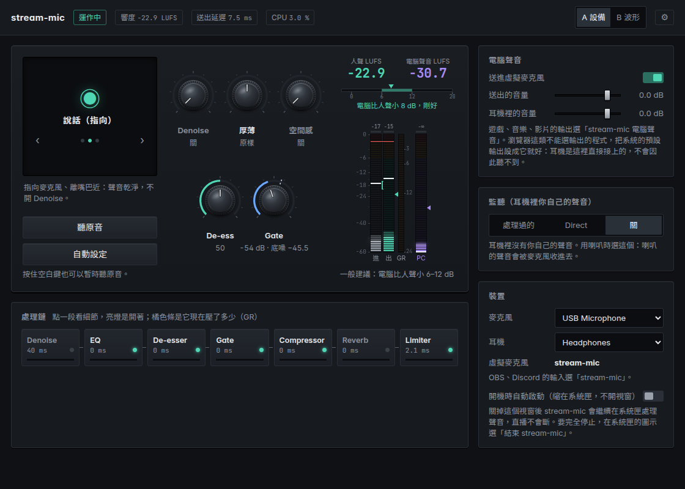
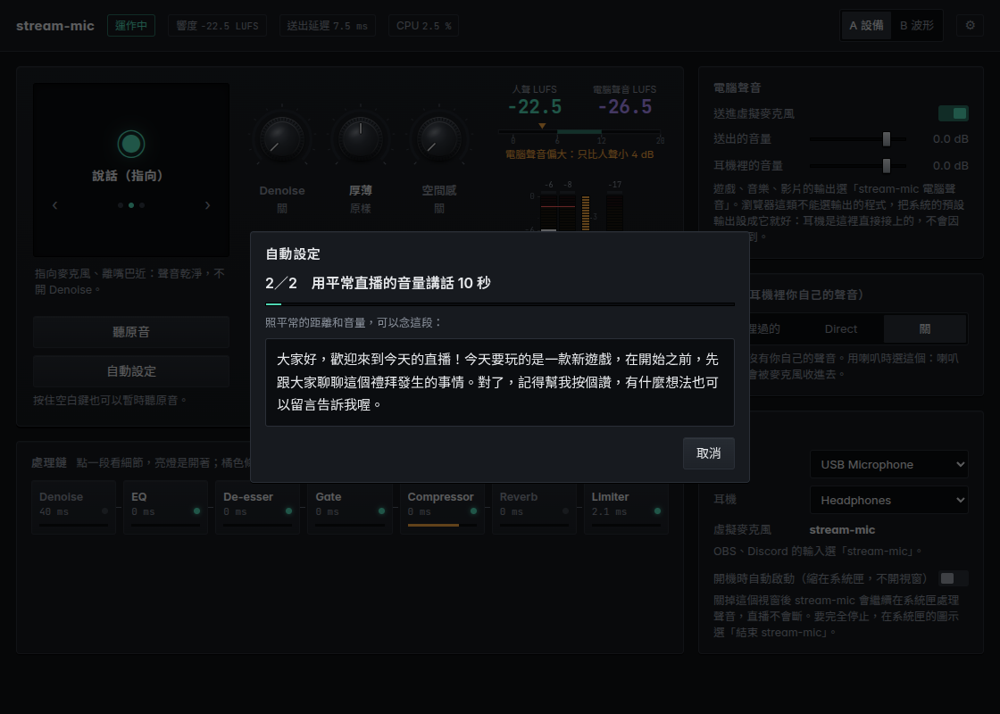
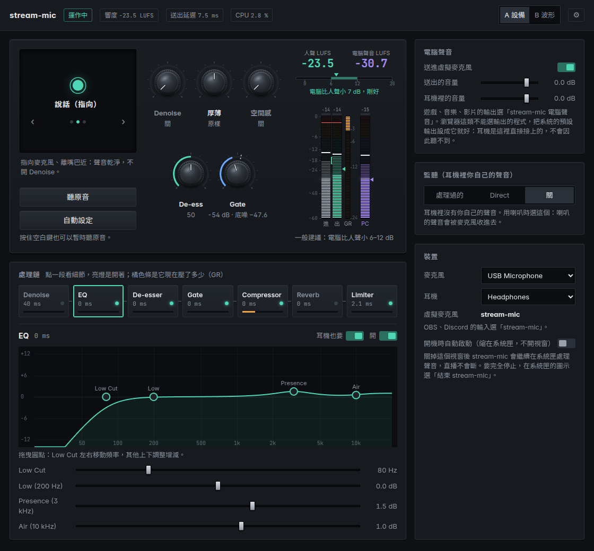
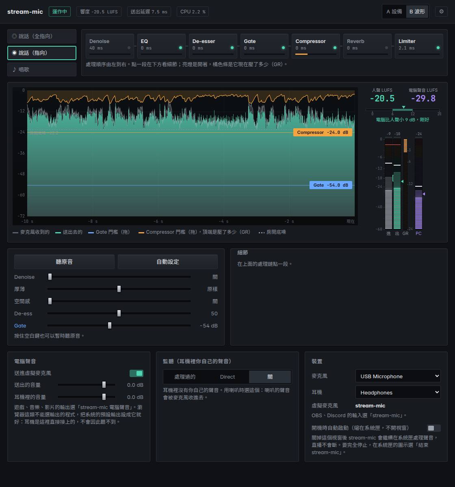

# stream-mic 使用說明

[English](guide.en.md) · [回到 README](../README.md)

stream-mic 會幫你的麥克風做降噪、EQ、去齒音、Gate、壓縮、空間感和限幅，處理好的聲音會變成一支虛擬麥克風。OBS 和 Discord 只要選這支虛擬麥克風就可以了。遊戲、音樂這類電腦聲音，也能一起混進去送出。

> 目前仍在開發中，還沒有正式版。

## 事前準備

**Windows**
- Windows 10 2004 以上，或 Windows 11。收錄電腦聲音需要用到這個版本之後才有的功能。
- VB-CABLE（虛擬音訊線）：stream-mic 會把處理好的聲音送到這裡。Windows 版的壓縮檔裡已經附上安裝檔，也可以到 [vb-cable.com](https://vb-audio.com/Cable/) 下載。

**Linux**
- PipeWire。Ubuntu 22.10、Linux Mint 22 以後的版本預設就是 PipeWire。
- WebKitGTK 4.1（顯示視窗）和 AppIndicator（系統匣圖示）：

      sudo apt install libwebkit2gtk-4.1-0 libayatana-appindicator3-1

**共通**
- 請戴耳機。用喇叭的話，喇叭的聲音會被麥克風收進去，電腦聲音就會重複送出兩次。

## 安裝

**Windows**
1. 把整個資料夾解壓縮到一個固定的位置，例如「文件\stream-mic」。`stream-mic.exe` 和 `WebView2Loader.dll` 必須放在同一個資料夾。
2. 安裝 VB-CABLE：
   1. 解壓縮 `VBCABLE_Driver_Pack` 壓縮檔。
   2. 在 `VBCABLE_Setup_x64.exe` 上按右鍵，選「以系統管理員身分執行」。
   3. 按「Install Driver」。
3. 執行 `stream-mic.exe`。第一次開啟時，Windows 可能會跳出「Windows 已保護您的電腦」，請按「其他資訊」，再按「仍要執行」。會出現這個警告，是因為程式沒有購買程式碼簽章憑證。

**Linux**

    tar xzf stream-mic-*-linux-*.tar.gz
    ./stream-mic-*-linux/stream-mic

## 開始使用

1. 在「裝置」選好你的麥克風和耳機。
2. 選擇模式（左上角的方塊，用 ‹ › 切換）：
   - **說話（全指向）**：適合筆電內建麥克風、領夾麥這類會收進整個房間聲音的麥克風。會稍微補一點厚度，高頻不額外提亮。
   - **說話（指向）**：適合貼近嘴巴使用的 USB 或 XLR 麥克風。清晰度和空氣感各加一點。
   - **唱歌**：長音不會被誤判成噪音，Gate 反應較慢、壓得較淺，有伴奏時會加一點殘響。
3. 按「自動設定」（見下一節）。
4. 在 OBS 和 Discord 選擇虛擬麥克風（見〈OBS 和 Discord〉）。

## 自動設定

自動設定分成兩個步驟：
1. **安靜 3 秒**：先別說話，音樂和影片也暫停。這一步是在測量房間本身的噪音。
2. **說話 10 秒**：用平常直播的距離和音量說話，不知道說什麼的話，可以念畫面上的那段文字。

完成後只會調整這三項：
- **Gate**：設在房間噪音上方約 10 dB（唱歌模式為 8 dB）。
- **Compressor**：設在你說話時大約壓下 3–4 dB 的位置。
- **Makeup**：把音量補到 -18 LUFS。

調整過的模式名稱旁會標示「改過」。不滿意的話，按「復原成之前的設定」就能回到原本的狀態。

遇到以下情況時，不會套用結果，畫面上會說明原因：
- 沒有收到人聲。
- 房間噪音和人聲差不多大。
- 麥克風太小聲，或大聲到快要破音：請調整麥克風或錄音介面的 gain，再試一次。
- 安靜的時候麥克風收到了電腦聲音：可能是錄音介面的 LOOPBACK 開著，或是正在用喇叭。

## 五顆旋鈕

| 旋鈕 | 作用 |
| --- | --- |
| **Denoise** | AI 降噪（DeepFilterNet3），去除風扇、鍵盤這類持續的噪音。開啟後會多出約 40 ms 的延遲，房間夠安靜就不需要開。唱歌模式最多只能開到「輕」，再強會把長音也當成噪音處理掉。 |
| **厚薄** | 往左轉聲音變薄：低頻減少、3 kHz 稍微加強、低切頻率往上移。往右轉聲音變厚：低頻增加、3 kHz 稍微減少。 |
| **空間感** | 加一點殘響。唱歌模式下，有伴奏時殘響較多，清唱或聊天時只剩三分之一。 |
| **De-ess** | 壓低ㄙ、ㄘ、ㄒ這類刺耳的齒音，數字越大壓得越多。 |
| **Gate** | 低於這個音量的聲音（例如停頓時的房間噪音）會被調小。旁邊會顯示測到的房間底噪，Gate 要設在底噪之上。轉到最左邊（-80 dB）就是關閉。 |

**聽原音**：用來比較處理前後的差別。也可以按住空白鍵暫時聽原音，放開就會恢復。

## 處理鏈

畫面下方的處理鏈，就是聲音實際經過的順序：

    Denoise → EQ → De-esser → Gate → Compressor → Reverb → Limiter

- 燈亮表示這一段正在運作。
- 橘色條表示這一段目前把聲音壓低了多少（GR）。
- 點選任一段可以展開細節：
  - 「開」：開啟或關閉這一段。
  - 「耳機也要」：決定耳機裡聽不聽得到這一段的效果。像 Denoise 這種會造成延遲的處理，可以只套用在送出去的聲音上。

**Low Cut** 是 EQ 前面獨立的一段，切掉 80 Hz 左右以下的轟聲（每八度 12 dB），在細節裡調頻率。「厚薄」往薄轉時會把它調高。

**EQ** 有五個控制點：
- **Low**（200 Hz）、**Air**（10 kHz）：上下拖曳，調整增減。
- **Mid**、**Presence**：上下調整增減、左右移動頻率，滑鼠停在點上轉滾輪調 Q。
- **High Cut**：左右拖曳，拉到最右邊是關。

畫面上的曲線就是實際的濾波結果：
- Low 和 Air 是 shelf 濾波器（Q 0.707），在中心頻率剛好是增減量的一半，所以控制點會落在曲線上。
- Presence 是鐘形濾波器（Q 1）。
- Q 值固定，不能調整。

## 兩種版面

右上角可以切換版面。兩種版面功能相同，只是排列方式不同：
- **A 設備**：像一台硬體效果器，有旋鈕和音量表。
- **B 波形**：顯示最近 10 秒的聲音波形，可以直接在波形上拖曳 Gate 和 Compressor 的門檻線。

右上角的 ⚙ 可以切換版面和語言（繁中、English）。

## 電腦聲音

讓遊戲、音樂和你的聲音一起送出去。

**Windows**
- stream-mic 會自動收錄電腦裡其他程式的聲音，不需要更改任何程式的輸出設定。
- 耳機裡的電腦聲音由 Windows 直接播放，不經過 stream-mic。

**Linux**
- 在系統的音效設定或 pavucontrol，把遊戲、音樂的輸出改成「stream-mic 電腦聲音」。
- 瀏覽器這類無法個別選擇輸出的程式，可以把系統預設輸出設成「stream-mic 電腦聲音」。耳機由 stream-mic 直接輸出，所以你一樣聽得到。

**設定項目**
- **送進虛擬麥克風**：開啟後，電腦聲音會和人聲一起送出。
- **送出的音量**：送出去的電腦聲音有多大。
- **耳機裡的音量**：只影響你自己在耳機裡聽到的大小。

音量表上方會比較人聲和電腦聲音的響度（LUFS）。一般建議電腦聲音比人聲小 6–12 dB，太大或太小時都會提示。

> 如果 OBS 另外擷取了「桌面音效」，請關掉「送進虛擬麥克風」，否則電腦聲音會重複兩份。

## 監聽（耳機裡你自己的聲音）

| 選項 | 說明 |
| --- | --- |
| **處理過的** | 耳機裡聽到的是處理過的聲音（會造成延遲的段落會略過）。在 Linux 上，電腦聲音也是從這裡混進耳機。 |
| **Direct** | 使用錄音介面本身的 Direct Monitor（直接監聽）：沒有延遲，但聽到的是未經處理的聲音。這時 stream-mic 不會再把你的聲音送進耳機，避免聽到兩次。 |
| **關** | 耳機裡不會有你自己的聲音。使用喇叭時請選這個。 |

## OBS 和 Discord

| | Windows | Linux |
| --- | --- | --- |
| OBS：音訊輸入擷取 | CABLE Output (VB-Audio Virtual Cable) | stream-mic |
| Discord：語音設定的輸入裝置 | CABLE Output (VB-Audio Virtual Cable) | stream-mic |

請不要在 OBS 或 Discord 裡監聽這個輸入，再讓它回到電腦聲音，這樣會形成回授。偵測到回授時，stream-mic 會先暫停電腦聲音，並在畫面上提示。

## 系統匣與開機啟動

- 關閉視窗不會停止處理，stream-mic 會縮到系統匣繼續運作，直播不會中斷。
- 要完全關閉，請在系統匣圖示的選單選「結束 stream-mic」。
- 系統匣選單也可以重新打開視窗，或切換聽原音。
- 在「裝置」打開「開機時自動啟動」後，開機時只會出現在系統匣，不會跳出視窗。

設定檔位置：
- Windows：`%APPDATA%\stream-mic\settings.json`
- Linux：`~/.config/stream-mic/settings.json`

**移除**
1. 關閉「開機時自動啟動」。
2. 從系統匣結束程式。
3. 刪除程式資料夾，以及上面的設定資料夾。
4. Windows 的 VB-CABLE 要另外移除：再執行一次它的安裝程式，按「Remove Driver」。

## 疑難排解

出問題時，畫面上方會顯示提示：

| 提示 | 處理方式 |
| --- | --- |
| 偵測到回授 | OBS 或 Discord 正在把 stream-mic 監聽到電腦聲音裡。請關掉那邊的監聽。 |
| 聲音太大，已自動壓住 | 人聲加上電腦聲音超過上限，超出的部分已經平滑壓住，不會破音。如果經常出現，請把「送出的音量」調低一點。 |
| 沒有找到 VB-CABLE（Windows） | 請安裝 VB-CABLE，裝好後 stream-mic 會自動接上。 |
| 之前選的裝置找不到 | 會先改用系統預設的裝置，裝置插回去後會自動切換回來。 |

回報問題時，請附上發生的時間、當時的操作，以及畫面截圖。

## 授權

stream-mic 採用 Apache License 2.0 授權。使用到的第三方元件及其授權，列在 NOTICE 和 THIRD_PARTY_LICENSES.txt。

VB-CABLE 是 VB-Audio Software 的軟體，不屬於 stream-mic，也不在 stream-mic 的授權範圍內。
- 來源：www.vb-cable.com
- VB-CABLE is a donationware, all participations are welcome.（VB-CABLE 是捐贈軟體，歡迎贊助作者。）
- 在公司、學校或公家機關使用時，VB-Audio 要求購買授權。
